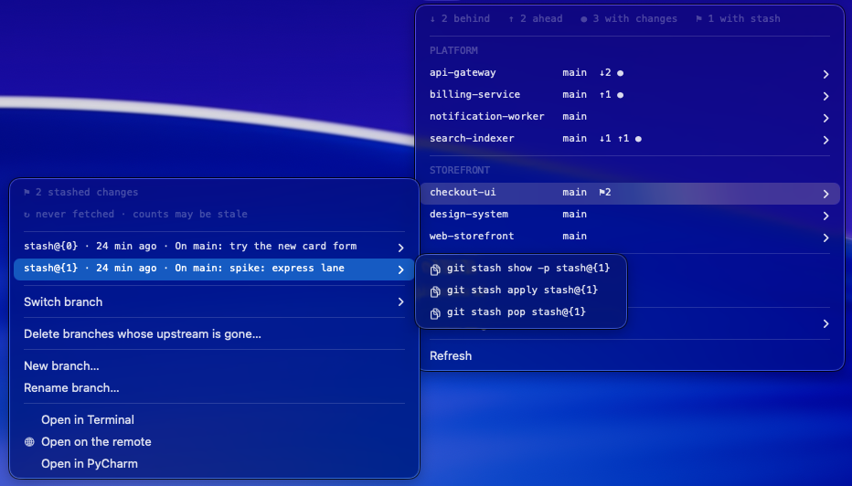
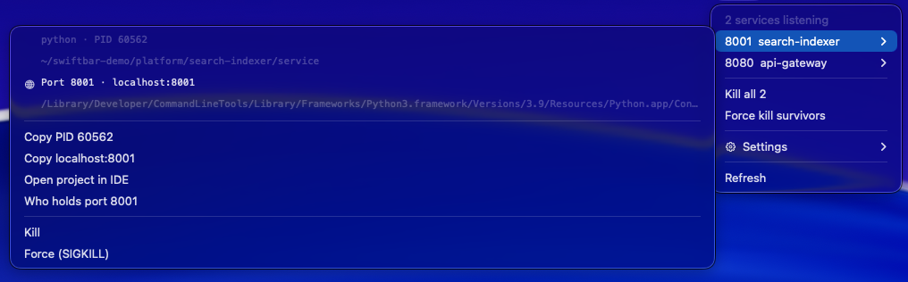
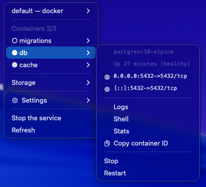
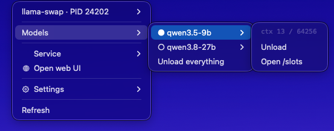

<h1 align="center">swiftbar-devkit</h1>

<p align="center">
  <b>Four macOS menu bar tools that answer the questions you keep opening a terminal for.</b>
</p>

<p align="center">
  
  
  
  
</p>

> **Work in progress, shared as-is.** A personal project with bugs I have not
> found yet. It kills processes, deletes branches and removes containers when
> you ask it to — read what a button says before clicking. Use at your own
> risk; I take no responsibility for what it does to your machine. Issues and
> pull requests welcome.

```bash
git clone https://github.com/cchinchilla-dev/swiftbar-devkit.git
cd swiftbar-devkit && bash install.sh
```

<p align="center">
  
</p>

Thirty repositories and no idea which three are behind. Something still holding
port 8080, and `lsof` telling you it is `java`. The VM up while `docker ps` says
nothing. A 13 GB model resident while you open one more Chrome window. Four
commands, in four terminals, that you will run again in ten minutes — kept on
screen instead, with the fix one click away.

- **Repos** — every repository, what is wrong with it, and the commands that fix it
- **Dev ports** — which of *your* services still hold a port, and a safe way to stop them
- **Colima** — the container VM and everything inside it
- **llama-swap** — the local model server, and what it is costing you

Bash and the Python macOS ships with: nothing from npm, no daemon of its own, no
telemetry, one config file. The installer asks which bars you want — one, some
or all — and offers their dependencies (`colima`, `llama-swap`, `llama.cpp`,
`jq`) through Homebrew. It never uninstalls anything.

## Repos

Every repository under your roots, grouped by folder, with the exact commands to
fix whatever is wrong.

- **Branches** local and remote: switch between them, or clear out the ones
  whose remote is gone. A dirty tree is offered a stash first.
- **Stashes** listed one by one, each with its own `show` / `apply` / `pop`.
- **Half-finished rebases, merges and cherry-picks** are detected, and anything
  that would make them worse is hidden.
- **Fetch all** eight at a time, and hide the repositories that are fine.
- **Open in your IDE or on the remote** — a Maven module opens in IntelliJ even
  when PyCharm is what you configured.
- **Actions guard themselves**: update refuses on a dirty tree, push refuses
  when the remote is ahead, branch deletion uses the form git can refuse, and
  nothing that rewrites history starts mid-operation.

## Dev ports

The services holding local ports — and only yours; editors, language servers and
system daemons are filtered out.

<p align="center">
  
</p>

- **Named after the project**, not the file, because entry points tend to all be
  called `main.py`.
- **Java, Python, Node, Bun, Deno, Go.** Debug ports labelled and demoted.
- **Open, copy or kill**: the port in a browser, the PID on the clipboard, the
  project in your IDE.

> **A kill verifies what it is about to kill.** Fifteen seconds can pass between
> the menu being drawn and the click, and macOS reuses PIDs — so it records the
> executable *and* its start time and refuses unless both still match. The name
> alone settles nothing when every JVM is called `java`.

## Colima

The container VM and everything in it, for
[Colima](https://github.com/abiosoft/colima) instead of Docker Desktop.

<p align="center">
  
</p>

- **Containers** with status, logs, a shell, clickable ports and the ID on the
  clipboard. Removing one asks first.
- **Compose projects**, image and VM disk usage with a warning threshold.
- **Fix registry credentials**, for when leaving Docker Desktop leaves
  `~/.docker/config.json` naming a helper that no longer exists.
- **Three separate states**: the VM being up, the Homebrew service being
  registered and Docker actually answering. Conflating them is how a bar ends
  up lying to you, so each has its own fix.

## llama-swap

The local model server, for [llama-swap](https://github.com/mostlygeek/llama-swap)
in front of [llama.cpp](https://github.com/ggml-org/llama.cpp). You need both —
llama-swap installs happily without llama.cpp, and then every load fails.

<p align="center">
  
</p>

- **Which model is loaded**, named in the menu bar itself.
- **Load, unload or switch** — with an exclusive group, loading *is* switching.
- **What it costs**: RAM against the machine's total, GPU, swap, and the context
  window in use. Loading asks first — it evicts whatever is resident and reads
  gigabytes off disk.

## Configure

One file, written by the installer. The bars run without it, on the defaults:

```bash
~/.config/swiftbar-devkit/config.sh   # the minimum worth setting:
REPOS_ROOTS=("$HOME/Projects")
REPOS_IDE="PyCharm"
```

Plain `KEY="value"` only. Every bar sources it, so anything in it is shell code
running every few seconds — the settings menus escape `$`, backticks and quotes
when they write a value, and leave `$HOME` working so the file stays portable.
Keep it out of git: it is the one file likely to name internal things.

Every key, with its default and what it is for, lives in
[`config.example.sh`](config.example.sh) — which is also what the installer
copies into place, so the documentation and the file you edit are the same file.

<details>
<summary>What the installer touches</summary>

Installs the Command Line Tools, Homebrew and SwiftBar if missing, symlinks the
bars you picked, asks where your repositories live and which editor you use,
then points SwiftBar at the plugin folder and starts it.

Symlinks rather than copies, so pulling updates the bars. Anything already in
those locations is moved aside with a timestamp, never overwritten. An existing
config is kept. It never asks for your password — Homebrew's own installer
might. If Docker Desktop is installed it says so, since it and Colima both
provide `docker`, but **it will not remove it**.

`bash install.sh --uninstall` removes the symlinks and leaves everything else.
</details>

## Tests

```bash
bash test/tests.sh
```

Fixture repositories built from scratch each run, and stubbed `colima`, `docker`
and `curl`, so every state is reachable without touching your machine.
Deliberately small and aimed at what can lose work: that switching branches
during a half-finished merge changes nothing, that a kill refuses unless the
process is still the one the menu recorded, that a config file cannot switch off
the confirmation guarding a batch `SIGKILL`, and that every button points at a
script that exists.

## License

MIT — see [LICENSE](LICENSE). No warranty of any kind.
