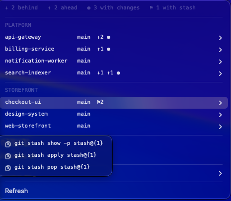
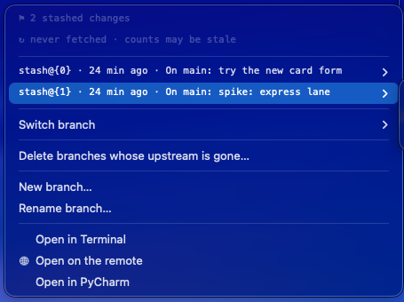

# Screenshots

Every menu below is real output, taken against dummy repositories and services.

## Repos

The list: each repository with what is wrong with it at a glance.

A repository opened: stashes, branches, and the commands that fix whatever it is
showing.

## Dev ports

Your services holding a local port, named after their project rather than their
entry point.

## Colima

The container VM, its containers, and the disk they are using.

## llama-swap

Which model is loaded, and what it is costing you.

